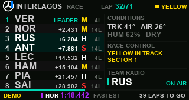
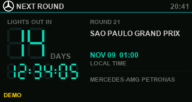
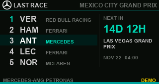
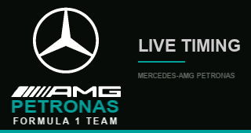

<div align="center">

# F1 Tower

**ESP32-S3 上的 F1 实时计时牌 · Mercedes-AMG Petronas 涂装**

一块 1.9 英寸 IPS 小屏，比赛时看实时排名、圈速、无线电和天气；没有比赛的日子，看上一站成绩和下一站倒计时。


</div>

## 界面预览

| 比赛进行中 | 下一站倒计时 | 上一站成绩 |
|:---:|:---:|:---:|
|  |  |  |

> 以上为固件 UI 的离线逐像素渲染（`tools/render_ui.py`），画面中的 DEMO 标签表示这是模拟数据；实机上跑真实数据源时标签会变成 `LIVE DATA`。

<div align="center">

</div>

## 功能

**比赛进行中（LIVE）**

- 8 行车手榜：名次、三字母简称、与领先者的差距、当前轮胎配方与圈龄
- 目标车队（Mercedes）整行高亮，切换 `TARGET_TEAM` 即可换主队
- 顶栏：分站名、圈数进度、黄旗/SC/VSC/红旗状态
- 右侧栏：赛道与气温、湿度、干湿状态；Race Control 最新消息；Team Radio 当前发言的车手
- 底部跑马灯：全场最快圈（紫）与个人最快圈（绿）像无线电一样轮流弹出，4 秒一条、不常驻
- 圈速记录从中途开机也能补全：启动时先静默回填历史圈速，之后只增量查询

**没有比赛时（IDLE）**

- 下一站：倒计时（天 + 时:分:秒）、分站名称、本地开赛时间
- 上一站：前五名车手与车队，目标车队高亮；同时给出下一站还有多久

**通用**

- 开机自检：WiFi → NTP → OpenF1/Jolpica，逐阶段显示进度
- 断网自动重连；连续失败则进入自演示模式（DEMO），画面上明确标注，不会把假数据当真数据
- 屏幕与车标全部由代码绘制：三叉星遮罩、AMG 速度斜杠、PETRONAS 字标，没有位图资源

## 按键（BOOT，GPIO0）

| 操作 | 作用 |
|:---|:---|
| 单击 | 依次切换背光：明亮 150 / 昏暗 90 / 夜间 40 |
| 双击 | IDLE 页在「倒计时 / 上一站成绩」之间切换 |
| 长按 0.9 s | 立即刷新全部数据并重连（不用等轮询周期） |

## 硬件

| 部件 | 说明 |
|:---|:---|
| 主控 | ESP32-S3，16 MB Flash + 8 MB OPI PSRAM（ESP32-1732S019N 一体板） |
| 屏幕 | 1.9" IPS，ST7789，原生 170×320，横屏使用 |
| 下载 | CH340 USB 串口（`/dev/cu.usbserial-110`） |
| 输入 | 板载 BOOT 键 |

接线（SPI，HSPI）：

| 信号 | GPIO |
|:---|:---:|
| MOSI | 13 |
| SCLK | 12 |
| CS | 10 |
| DC | 11 |
| RST | 1 |
| BL | 14 |

## 软件依赖

| 组件 | 版本 |
|:---|:---|
| arduino-esp32 | 3.3.12 |
| TFT_eSPI | 2.5.43 |
| ArduinoJson | 7.4.3 |

TFT_eSPI 需要按本板改 `User_Setup.h`：

```cpp
#define USER_SETUP_INFO "ESP32-1732S019N 170x320"
#define ST7789_DRIVER
#define TFT_WIDTH  170
#define TFT_HEIGHT 320
#define TFT_MISO  -1
#define TFT_MOSI  13
#define TFT_SCLK  12
#define TFT_CS    10
#define TFT_DC    11
#define TFT_RST    1
#define TFT_BL    14
#define TFT_BACKLIGHT_ON HIGH
#define USE_HSPI_PORT
#define SPI_FREQUENCY 40000000
```

## 编译与烧录

```bash
arduino-cli core install esp32:esp32@3.3.12
arduino-cli lib install "TFT_eSPI@2.5.43" "ArduinoJson@7.4.3"

# 凭据只放在本地，secrets.h 已被 .gitignore 忽略
cp f1tower/secrets.example.h f1tower/secrets.h
$EDITOR f1tower/secrets.h

FQBN="esp32:esp32:esp32s3:PSRAM=opi,FlashSize=16M,PartitionScheme=app3M_fat9M_16MB"
arduino-cli compile --fqbn "$FQBN" f1tower
arduino-cli upload -p /dev/cu.usbserial-110 --fqbn "$FQBN" f1tower
```

`secrets.h` 留空也能编译：固件会直接进入 DEMO 模式，用于无网络时验屏。

## 数据源与轮询

| 数据 | 来源 | 周期 |
|:---|:---|:---:|
| 当前场次 / 状态 | OpenF1 `/sessions` | 30 s |
| 实时排名 | OpenF1 `/position` | 2 s |
| 与前车差距 | OpenF1 `/intervals` | 6 s |
| 圈速（最快圈 / PB） | OpenF1 `/laps` | 6 s（回填时 250 ms 一段） |
| 轮胎配方与圈龄 | OpenF1 `/stints` | 30 s |
| 天气 | OpenF1 `/weather` | 30 s |
| Race Control | OpenF1 `/race_control` | 8 s |
| Team Radio | OpenF1 `/team_radio` | 10 s |
| 赛历 / 上一站成绩 | Jolpica `api.jolpi.ca/ergast/f1` | 5 min |

## 目录结构

```
f1tower/
  f1tower.ino    模式调度、按键、断网恢复
  f1data.cpp/h   OpenF1 + Jolpica 抓取与解析、圈速账本
  net.cpp/h      WiFi、NTP、HTTPS、PSRAM 响应缓冲
  ui.cpp/h       三个页面与跑马灯
  theme.cpp/h    颜色、矢量三叉星与 AMG 字标
  assets.h       工具生成的位图字体与星形遮罩
  config.h       引脚、轮询周期、布局常量
  secrets.example.h
tools/
  gen_assets.py  生成字体与车标遮罩
  render_ui.py   离线渲染固件 UI（README 里的截图）
  preview_*.py   车标/启动页预览
  wifiscan/      链路诊断 sketch（pmf、重连原因码）
```

## 一些踩过的坑

- **OpenF1 的空结果返回 404 而不是 `[]`**，解析层必须把 404 当作"暂无数据"。
- **`getStreamPtr()` 读大响应会中途卡死**：改为 `writeToStream()` 写进 PSRAM 缓冲（上限 320 KB）。
- **一场完整比赛的 `/laps` 约 700 KB**，超过单次缓冲上限；因此按 8 圈一段分块回填，并用 `lap_number>=` / `lap_number<=` 限定。
- **`/intervals` 只要给了 `date>=` 就会重放整个 session**，必须同时给 `date<=` 才能把量压到 30 秒窗口。
- **出站圈（`is_pit_out_lap`）必须排除**，否则会污染车手的最快圈基线。
- **`/laps` 里嵌套着 `segments_sector_*` 数组**，扁平解析器会在这里越界，必须跳过未知字段。
- WiFi 断连时先 `WiFi.disconnect()` 再 `begin()`，否则协议栈会回 "sta is connecting, cannot set config" 并永远不再重试。

## 免责声明

本项目为个人非商业作品，与 Formula 1、Mercedes-AMG Petronas F1 Team 无关。相关商标、车队名称与图形归各自权利人所有，仅用于个人设备外观致敬。实时数据来自 [OpenF1](https://openf1.org) 与 [Jolpica-F1](https://github.com/jolpica/jolpica-f1)，请遵守其使用条款。

## License

[MIT](LICENSE)
